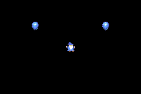

# orbits
An exercise for learning about header files in C++. See instructions [here](./instructions.md)

# i cast fireball!

You are a powerful wizard who just wants to cast fireballs!
Press A to make fireballs and run around with them orbiting you!
Be wary of the pesky water drops that move up the screen as they will douse your flames!

https://github.com/uglybrecke?tab=repositories